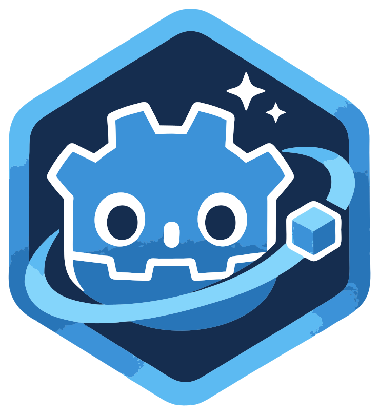

<p align="center">
  
</p>

<h1 align="center">Godot Hub</h1>

<p align="center">
  A lightweight desktop companion for managing multiple Godot engine builds and your Godot projects — built entirely with Godot.
</p>

<p align="center">
  
  
  
  
</p>

---

## Overview

**Godot Hub** is a small, self-hosted alternative to Unity Hub for the Godot ecosystem. It keeps multiple Godot versions side by side, remembers which engine each project uses, and launches projects with the right executable — no more juggling folders or renaming binaries.

The app is written in **GDScript** with **static typing**, follows a feature-oriented structure, and ships with a dark theme and Vietnamese/English localization.

## Features

- **Multiple engine versions** — keep Standard and Mono builds side by side.
- **Flexible installation** — add an existing executable, download a `.zip` from a URL, or browse official GitHub releases.
- **Automatic extraction** — downloaded archives are extracted into the app's data directory and registered automatically.
- **Project library** — import projects from `project.godot`, rename, open, and remove them from a single list.
- **Per-project engine binding** — each project remembers its assigned engine across restarts.
- **Fast launch** — select a project and press **Open project**, or simply **double-click** it.
- **Context menus** — right-click a project or version card for quick actions.
- **Themed UI** — a consistent dark theme powered by a single `Theme` resource.
- **Localization** — Vietnamese and English out of the box, switchable at runtime.

## Requirements

- **Godot Engine 4.7** or newer (stable).
- Windows, Linux, or macOS.
- An internet connection for downloading engine builds from GitHub (optional).

## Getting started

### Run from source

```bash
git clone https://github.com/imxuanmanh/godot-hub.git
```

1. Open Godot 4.7+.
2. Choose **Import** and select the `project.godot` file in the cloned folder.
3. Press **F5** (or click **Run**) to start the app.

### Build a release

1. Install the export templates for your Godot version.
2. Open **Project → Export**.
3. Select the **Windows Desktop** preset (or add a preset for your platform).
4. Export to `Godot Hub.exe` in the project root.

The export preset writes `Godot Hub.exe` and `Godot Hub.pck` next to each other; keep them together when distributing the app.

## Usage

### Versions tab

- **+ Add version** opens a dialog with three sources:
  - **From file** — pick an existing Godot executable.
  - **From URL** — paste a direct link to a Godot `.zip` package.
  - **Available** — fetch the latest releases from GitHub, then download in one click.
- **Set as default** — the default engine is preselected when adding new projects.
- **Remove** — removes the version from the list (the executable on disk is left untouched).

### Projects tab

- **+ Add project** — select a project's `project.godot` file.
- Select a project, choose an engine from the **Godot version** dropdown, then click **Open project**.
- **Double-click** a project to open it with its assigned engine.
- **Right-click** a card to open, or remove the project from the list.

## Data and storage

All app data is stored under the Godot `user://` directory:

| Platform | Location |
| --- | --- |
| Windows | `%APPDATA%\Godot\app_userdata\Godot Hub\` |
| Linux | `~/.local/share/godot/app_userdata/Godot Hub/` |
| macOS | `~/Library/Application Support/Godot/app_userdata/Godot Hub/` |

Key files:

- `godot_hub_data.json` — versions, projects, and preferences.
- `versions/` — extracted engine builds.
- `downloads/` — temporary download files.
- `godot_manifest_cache.json` — cached GitHub release manifest.

Deleting this folder resets the app to a clean state. Your actual Godot projects are never modified.

## Project structure

```
godot-hub/
├─ core/                     # Shared infrastructure and utilities
├─ locales/                  # Vietnamese and English translations
├─ modules/
│  └─ version_manager/       # Engine discovery, download, and install logic
├─ ui/                       # Tabs, list cards, dialogs
│  └─ theme/                 # Application theme
├─ assets/                   # Logos and icons
├─ Main.gd / Main.tscn       # Application shell
├─ export_presets.cfg        # Export configuration
└─ project.godot             # Godot project file
```

## Roadmap

- [ ] Automatic update checks for installed engines.
- [ ] Project templates.
- [ ] Persistent options for engine and project settings.
- [ ] Automated tests for pure logic (version parsing, project metadata).
- [ ] Additional export targets and installers.

## Contributing

Issues and pull requests are welcome. Please keep changes focused, follow the existing GDScript style, and make sure the project opens in Godot without parse errors.

## License

Released under the [MIT License](LICENSE).
